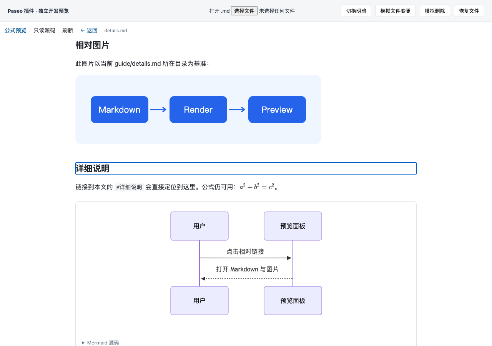

# Paseo Markdown + Math

独立 Paseo 文件面板插件 v0.3.0。为已有 Markdown 文件提供 **KaTeX 公式、Mermaid 图表、图片和文档链接**，通过 `addFilePanel` 注册，不修改 Paseo 主项目，不依赖 Canvas。

## 使用

安装后，在 Paseo 工作区的文件面板打开 Markdown，选择 **Open with → Markdown + Math**。可用本仓库的 `examples/math-demo.md` 体验公式、图表、图片与文档导航。

- 保存原 Markdown 后自动更新；点击「刷新」重新读取内容和本地图片。
- 点击相对 Markdown 链接在当前面板打开，点击「← 返回」回到上一文档。
- 链接打开的文档每 2 秒检查更新；「只读源码」查看当前文档。
- 仅图片文件发生变化时，点击「刷新」加载新图片。
- 插件不修改原文件或默认文件关联。编辑请使用原编辑器。

插件按 host 安装；使用远程工作区时，需要在对应的 0.13.x 主机上另行安装。



## 支持内容

| 内容 | 行为 |
| --- | --- |
| `.md` / `.markdown` / `.mdown` / `.mkd` | 可选文件面板，大小写不敏感 |
| 标题、列表、引用、表格、代码块 | 标准 Markdown；代码不执行，不做语法高亮 |
| `$...$`、`$$...$$`、`\(...\)`、`\[...\]`、math 围栏 | KaTeX；分式、矩阵、对齐环境等 |
| mermaid 围栏 | 本地 Mermaid 12.2；已验证流程图、时序图；可展开源码 |
| 本地图片 | PNG/JPEG/GIF/WebP/AVIF/SVG/BMP；浏览器支持的格式可显示 |
| HTTP(S) 图片 | 桌面/Web 直接加载；原生预览显示可点击链接，由设备浏览器打开 |
| 相对路径 | 以当前显示的 Markdown 所在目录为基准，支持中文、空格编码、`../` |
| `/assets/a.png` | 从当前工作区根目录查找，不是系统根目录 |
| 相对 Markdown 链接 | 当前面板打开，支持 `#标题` 定位和返回 |
| 文内锚点 | 自动生成标题 ID，支持中文；同名标题追加 `-1`、`-2` |
| HTTP(S) 链接、裸网址 | 用户点击打开独立页面，隔离 opener |
| 无效公式/图表、缺失图片 | 就地显示提示，保留其余文档 |
| 原生 iOS / Android | 主机渲染为高清图像，在原生面板显示；iOS 提供双指缩放，真机尚待验收 |

示例：

````markdown
行内公式 $E=mc^2$。


[另一个文档](./guide/details.md#详细说明)
[本页标题](#图片与链接)
````

原始 HTML 转义显示。完整 TeX 文档、TikZ、MDX、任意宏包、非 Markdown 本地文件链接、`file:` / `mailto:` 等协议不在支持范围。Mermaid 的交互回调、HTML 标签与外部图片等受严格模式和内容策略限制；并非全部 Mermaid 配置均可用。

## iOS 公式与 Mermaid 预览（v0.3）

iPhone 连接的 **Paseo 主机**需安装 Chrome、Edge 或 Chromium，iPhone 不需要安装浏览器扩展或 TeX。在主机更新插件后，在手机重新打开 Markdown + Math 文件面板。旧版把所有原生平台直接切到源码；v0.3 改用主机生成的 2 倍分辨率 PNG 分片，并叠加可点击的文档链接。

- 支持与桌面相同的 KaTeX 语法、Mermaid 引擎、本地图片、相对文档/锚点/外链、明暗主题和自动更新。
- iOS 双指缩放可放大至 4 倍。图像中的文字不能直接选择；复制请切换「只读源码」。Mermaid 源码也可从源码视图查看。动态图像只保留截图时的一帧。
- 每次预览启动独立的无头浏览器和临时资料目录，结束后关闭、清理；不使用个人浏览器资料、不自动下载浏览器、不开放调试端口。
- 无头浏览器的文档资源请求被阻止。本地图片经工作区边界检查后内嵌，网络图片改为链接，避免由主机代为访问任意地址。
- 非标准浏览器路径可在**启动 daemon 的环境**中设置 `PASEO_MARKDOWN_BROWSER`，值为可执行文件的完整路径。仅在终端里设置不会影响已经运行的桌面 daemon；重新启动后生效。
- 浏览器执行限 20 秒，排队限 2 秒；最多一个渲染任务和两个短暂排队请求。失败显示原因并提供「重试预览」，源码始终可用。
- 移动端限 120,000 字符、24,000 CSS 像素高度、1,600 万输出像素和 8 MiB 编码图像数据，以先达到者为准。

实现完全在插件仓库内，没有修改 Paseo 主项目或调用私有原生 WebView。已验证主机渲染与 RN Web 原生分支适配器；**尚未完成 iPhone 真机、iOS 双指手势和 Android 验收**。无浏览器的主机仍可使用桌面/Web 预览及移动端源码。

## 从 npm 安装

在目标 Paseo daemon 所在主机执行：

```sh
paseo plugin install npm:paseo-markdown-math@0.3.0
```

也可在 Paseo「设置 → 插件」填写 `npm:paseo-markdown-math@0.3.0`。这是插件包，不是供应用代码导入的 JavaScript 库。需要 Paseo 0.13.x 和可用的 npm。

npm 包包含字体、Mermaid 生成资源和固定的运行依赖，不会在安装时下载开发工具或重新构建前端。npm 12 已移除 shrinkwrap 支持，因此使用 `bundleDependencies` 固定随包发布的运行依赖树。

## 从源码开发

需要 Node.js 22.12+、Paseo 桌面/Web 客户端及对应 daemon **0.13.x**。当前声明 `>=0.13.0 <0.14.0`。

```sh
git clone https://github.com/Under-no-Flag/paseo-markdown-math.git
cd paseo-markdown-math
npm ci
npm run check
paseo plugin install "$PWD"
paseo plugin ls paseo-markdown-math --json
```

宿主需要已启用插件。v0.2 新增只读服务端入口，由 Paseo 启动，用于读取当前工作区内的图片和链接文档；不开放独立网络端口。Git 源安装在缺少生成资源时执行 `npm ci --include=dev --ignore-scripts` 和 `npm run assets`；已打包的 npm 安装会跳过这一步。

```sh
npm run dev
# http://127.0.0.1:5173/
```

开发页加载真实编译后的客户端及 SDK hooks，本地中间件使用同一服务端资源读取函数。文件句柄、工作区和主题由适配器提供，不连接 Paseo daemon。示例相对资源可正常访问。浏览器选择的任意文件仅加载文本，无法获知其所在目录，因此相对资源会提示使用 Paseo；刷新开发页可恢复项目示例。

修改源码后重启开发页构建并 reload Paseo：

```sh
npm run check
npm run verify:host
paseo plugin reload paseo-markdown-math --json
npm run dev
# 另一个终端，需已安装 Chrome：
npm run test:browser
npm run test:native
npm run test:native-ui
```

不承诺源码热更新。`verify:host` 使用安装的真实 Paseo 编译器验证客户端、服务端入口，并在无 DOM 的模拟 native 环境验证客户端注册/清理；它不是宿主 UI 或手机验收。可通过 `PASEO_COMPILER_PATH` 指定编译器内部路径，插件运行不依赖它。

## 实现与边界

- `index.client.tsx`：`addFilePanel` 注册。
- `client/panel.tsx`：SDK 文件监听、预览/源码、文档历史、链接文档轮询。
- `shared/render.ts`：桌面与主机共用的 Markdown/KaTeX/HTML 生成器；`client/render.ts` 保留导出入口。
- `client/native.tsx`：原生图像预览、缩放、链接层、重试与异步竞态处理。
- `server/native.ts`、`server/browser.ts`：只读资源内嵌、独立无头浏览器管道、截图与回收。
- `client/web.ts`：隔离 iframe 与带随机 token、来源校验的消息桥。
- `scripts/frame-runtime.ts`：仅在 iframe 内执行的 Mermaid、图片和链接交互；构建为字符串，不在 Paseo 原生宿主执行。
- `index.server.ts`、`server/resources.ts`：SDK RPC、工作区查找、只读资源解析。
- `shared/resources.ts`、`shared/native.ts`：资源读取和原生预览的 RPC 输入输出契约。
- `examples/`：流程图、时序图、中文路径 SVG、嵌套文档示例。
- `tests/`、`scripts/browser-test.mjs`：渲染、资源边界和浏览器交互验证。

KaTeX 字体与 Mermaid 都随包提供；公式、图表、本地图片不需要 CDN。桌面/Web 中明确写入文档的 HTTP(S) 图片和点击的外链需要网络；原生预览不让主机下载网络图片。React、React Native、Zod 与 Paseo SDK 由宿主提供。

文档 iframe 不允许同源访问和表单，脚本仅允许带随机 nonce 的打包渲染器。Markdown 禁用 HTML，KaTeX `trust:false`，Mermaid `securityLevel:strict`。这些约束针对文档内容，整个插件仍是受信任的 Paseo 扩展。

本地资源先校验工作区范围，再校验解析后的真实路径，拒绝路径越界和指向外部的符号链接。当前工作区有权限读取的普通文件才可作为资源。不支持敌对进程并发替换工作区目录的强隔离模型。

限制：单图 5 MiB、单页最多 32 张本地图片、图片合计约 20 MiB；链接文档读取限 2 MiB；预览限 500,000 个 UTF-16 字符；单页最多 20 个 Mermaid 围栏，每图 50,000 字符/1,000 边。字体、公式、图表复杂度仍会影响渲染时间。源码视图显示已读取的完整文本。

内容、主题或视图变化会重建预览；未保存滚动位置。链接历史仅保留在当前面板实例中。Paseo 0.13 没有公开的打开文件标签页接口，因此使用面板内导航。

## 检查与卸载

```sh
npm run check
npm run verify:host
paseo plugin logs paseo-markdown-math --json
paseo plugin disable paseo-markdown-math
paseo plugin remove paseo-markdown-math
```

移除插件不删除项目源文件。依据见 [API 核实](docs/API-RESEARCH.md)，实测范围见 [验收说明](docs/ACCEPTANCE.md)。

## 打包与发布

从 GitHub 克隆开发仓库后运行：

```sh
npm ci
npm run check
npm pack --pack-destination ..
npm run test:package
npm publish ../paseo-markdown-math-0.3.0.tgz --access public
```

`prepack` 生成资源。npm 包包含运行源文件、只读准备脚本、示例、文档和运行依赖；开发页、测试工具与构建工具只保留在 Git 仓库。`test:package` 把实际压缩包安装到开发仓库外的临时目录，禁用安装脚本及开发依赖，再用真实 Paseo 编译器验证客户端注册、服务端图片 RPC 和原生预览 RPC（需主机浏览器）。该测试需要本机 Paseo 0.13 CLI。

发布新版本前更新版本号和锁文件，完成上述验证；npm 发布和 Paseo 官方插件目录审核是两个独立步骤。本项目未声称通过官方目录审核。
