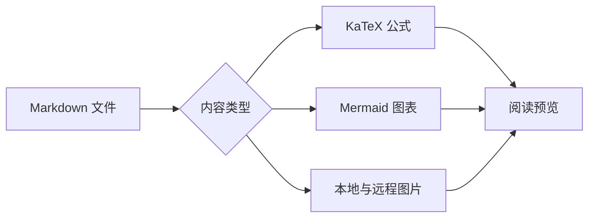

# Markdown + Math 公式预览

直接阅读已有 Markdown 文件，保存后自动同步。所有公式与字体均在本地渲染。

## 行内公式

爱因斯坦的质能关系 $E=mc^2$，以及 LaTeX 括号形式 \(e^{i\pi}+1=0\)。

## 推导与矩阵

$$
\begin{aligned}
\mathcal{L}(\theta) &= \frac{1}{N}\sum_{i=1}^{N}\left(y_i-f_\theta(x_i)\right)^2 \\
\theta_{t+1} &= \theta_t - \eta\nabla_\theta\mathcal{L}(\theta_t)
\end{aligned}
$$

\[
A=\begin{bmatrix}1 & 2 \\ 3 & 4\end{bmatrix},\qquad
\int_0^1 x^2\,dx=\frac{1}{3}
\]

## Markdown 结构

| 语法 | 效果 |
| --- | --- |
| 行内 | $a^2+b^2=c^2$ |
| 分式 | $\frac{\alpha}{\beta}$ |

> 支持标题、列表、表格、引用与代码。代码中的公式分隔符保持原样。

- 预览不会修改原文件。
- 不支持完整 LaTeX 文档、TikZ 或任意 TeX 宏包。

```python
# $x^2$ stays source code
loss = (prediction - target) ** 2
```

```math
\sum_{k=1}^{n} k=\frac{n(n+1)}{2}
```

## 无效公式与资源说明

错误公式 $\notARealCommand{x}$ 保留可见错误，不影响其余内容。

[KaTeX 支持的公式语法](https://katex.org/docs/supported.html)

## Mermaid 图表



## 图片与链接


[打开详细说明](./guide/details.md#详细说明) · [跳回行内公式](#行内公式) · [Mermaid 文档](https://mermaid.js.org/)

也支持自动链接：https://katex.org/
